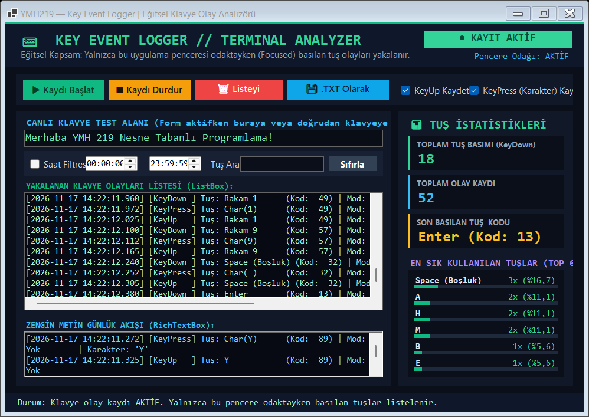
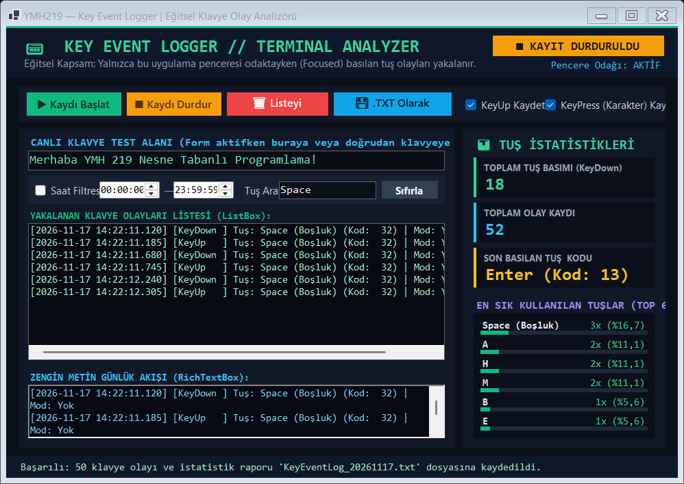

# ⌨️ YMH219 — Key Event Logger (Eğitsel Klavye Olay Analizörü)

> **Nesne Tabanlı Programlama (YMH 219)** dersi kapsamında C# ve Windows Forms kullanılarak geliştirilmiş, **Cyber-Terminal** arayüz tasarımına sahip eğitsel klavye olayı yakalama, istatistik ve günlükleme uygulaması.

---

## 📌 Proje Adı ve Kısa Açıklama

**YMH219-KeyEventLogger**, Windows Forms üzerinde klavye olaylarının (`KeyDown`, `KeyPress`, `KeyUp`) nasıl yakalandığını, milisaniye hassasiyetinde zaman damgasıyla nasıl biçimlendirildiğini, istatistiksel olarak nasıl analiz edildiğini ve `StreamWriter` ile yerel `.txt` dosyasına nasıl aktarıldığını gösteren **eğitsel amaçlı** bir masaüstü uygulamasıdır.

> **🔒 Kapsam ve Güvenlik Sınırı:** Bu uygulama gerçek bir sistem keylogger'ı değildir. Yalnızca kendi uygulama penceresi aktif/odaktayken (`Focused`) gerçekleşen tuş girişlerini yakalar. Global keyboard hook, gizli arka plan çalışması veya ağ üzerinden veri gönderimi kesinlikle içermez.

---

## 🛠️ Kullanılan Teknoloji / NuGet Paketleri

| Bileşen | Detay |
| :--- | :--- |
| **Programlama Dili** | C# 12 |
| **Çatkı (Framework)** | .NET (`net10.0-windows` / Windows Forms) |
| **Dosya İşlemleri** | `System.IO.StreamWriter` (UTF-8 Raporlama ve Günlük Kaydı) |
| **Veri Sorgulama** | `System.Linq` (Tarih/saat aralığı filtreleme ve en sık kullanılan tuş analizi) |
| **Harici NuGet Paketi** | Harici paket gerektirmez (Standart .NET Windows Desktop SDK ile çalışır) |

---

## 🚀 Kurulum ve Çalıştırma Adımları

1. **Depoyu klonlayın:**
   ```bash
   git clone https://github.com/fatmaturkmen244-spec/YMH219-KeyEventLogger.git
   cd YMH219-KeyEventLogger
   ```
2. **Visual Studio ile çalıştırma:**
   - `YMH219-KeyEventLogger.sln` dosyasını **Visual Studio 2022** (veya üzeri) ile açın.
   - `F5` tuşu ile projeyi derleyip başlatın.
3. **Komut satırı (.NET CLI) ile çalıştırma:**
   ```bash
   dotnet run --project KeyEventLoggerApp/KeyEventLoggerApp.csproj
   ```

---

## ✨ Uygulamanın Temel Özellikleri

- **Kapsamlı Klavye Olay Yakalama (`KeyDown`, `KeyPress`, `KeyUp`):**
  - Uygulama penceresi odaktayken basılan tuşun adı (`Space`, `Enter`, `Shift`, harf/rakam vb.), sanal tuş kodu (`KeyValue`), modifikatör tuşları (`Ctrl`, `Shift`, `Alt`) ve milisaniye hassasiyetinde zaman bilgisi (`yyyy-MM-dd HH:mm:ss.fff`) hem `ListBox` hem de `RichTextBox` üzerinde anlık olarak gösterilir.
- **Kayıt Durumu Kontrolü ve Görsel Gösterge:**
  - **Kaydı Başlat** ve **Kaydı Durdur** butonları ile olay yakalama durumu kontrol edilir.
  - Üst barda yer alan dinamik durum rozeti (`● KAYIT AKTİF` yeşil / `■ KAYIT DURDURULDU` kehribar) ve pencere odak göstergesi kullanıcıya anlık geri bildirim verir.
- **Temizleme ve `.txt` Dosyasına Kaydetme:**
  - **Listeyi Temizle** butonu ile ekrandaki ve bellekteki tüm kayıtlar sıfırlanır.
  - **.TXT Olarak Kaydet** butonu ile yakalanan tüm olaylar ve en sık kullanılan tuş istatistikleri `SaveFileDialog` ve `StreamWriter` kullanılarak düzenli bir rapor formatında kaydedilir.
- **Tuş İstatistikleri ve Tarih/Saat Filtreleme (İsteğe Bağlı Geliştirmeler):**
  - Sağ panelde toplam tuş basımı, toplam olay sayısı ve **En Sık Kullanılan 6 Tuş** yüzdesel ilerleme çubuklarıyla canlı olarak hesaplanır.
  - Kayıtlar başlangıç-bitiş saat aralığına veya tuş adına göre anlık olarak filtrelenebilir.

---

## 📸 Ekran Görüntüleri

### 1. Kayıt Aktif Görünümü — Canlı Olay Listesi ve Tuş İstatistikleri


### 2. Kayıt Durduruldu — Arama/Saat Filtreleme ve .TXT Dışa Aktarım Görünümü


---

## ⚠️ Bilinen Sınırlamalar / Geliştirme Notları

- Güvenlik ve ders kuralları gereği uygulama simge durumuna küçültüldüğünde veya başka bir pencereye geçildiğinde (`Deactivate`) klavye olaylarını toplamaz.
- Çok yüksek hızda basılı tutulan tuşlarda işletim sisteminin otomatik tuş tekrarlama hızı (`Key Repeat Rate`) kadar `KeyDown` olayı üretilir.

---

## 👤 Öğrencinin Adı-Soyadı ve Öğrenci Numarası

- **Adı Soyadı:** Fatma Türkmen
- **Öğrenci Numarası:** *(Öğrenci Numaranız)*
- **Ders:** YMH 219 — Nesne Tabanlı Programlama
